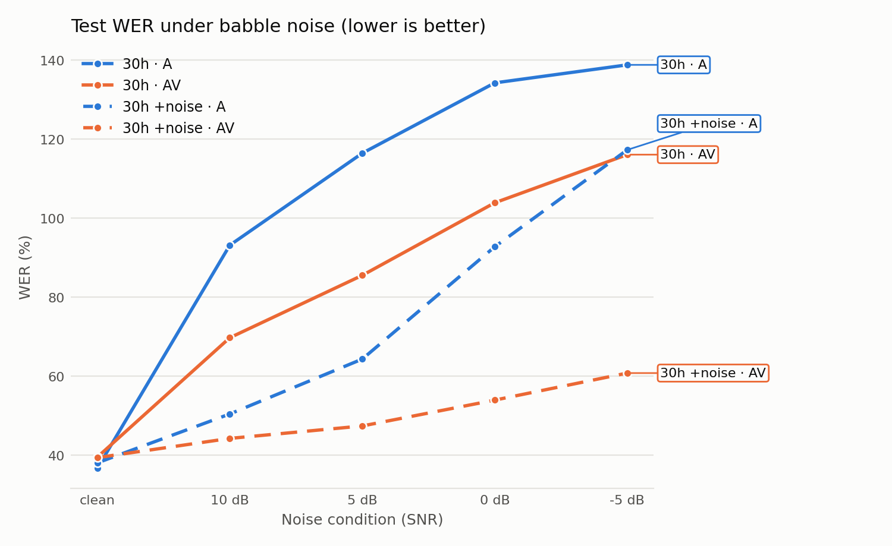
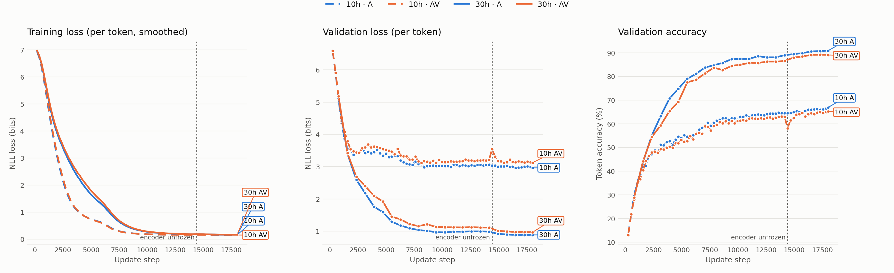

# 合成影像輔助鄒語影音語音辨識（Tsou Synthetic AVSR）

把 *Bootstrapping Audiovisual Speech Recognition in Zero-AV-Resource Scenarios with Synthetic Visual Data*
（Buitrago & Hernando, 2026）的方法，從加泰隆尼亞語搬到**臺灣原住民族語：鄒語**。
鄒語沒有任何「影像＋語音」的配對資料，我們用 Wav2Lip 從鄒語錄音生成說話影片，再微調 AV-HuBERT。

- 上游程式：[SynthAVSR](https://github.com/Pol-Buitrago/SynthAVSR)、[Wav2Lip](https://github.com/Rudrabha/Wav2Lip)、AV-HuBERT（版本見 `env/upstream_commits.txt`）
- 本 repo 只放我們自己寫的程式、實驗設定與結果；語料、音檔、影片、模型權重不在版控內

## 流程

| 步驟 | 程式 | 說明 |
|---|---|---|
| 1 | `scripts/data/remap_paths.py` | 語料清單的路徑改成本機路徑 |
| 2 | `scripts/data/make_subset.py` | 切 train 10h / 30h、valid、test；測試與驗證集用**未出現在訓練中的說話者**，並移除與其文字相同的訓練句，避免洩題 |
| 2b | `scripts/avhubert/check_manifest.py` | 檢查實際訓練清單的說話者與句子是否和測試／驗證集重疊 |
| 3 | `scripts/data/select_faces.py` | 從 FFHQ 用 dlib 篩選正臉、嘴部清晰的照片（同論文做法），每位說話者固定一張臉 |
| 4 | `scripts/wav2lip/batch_wav2lip.py` | 批次生成說話影片（Wav2Lip GAN，多 GPU） |
| 5 | `scripts/avhubert/batch_prep.py` | 裁出 96×96 嘴部影片、訓練 SentencePiece（unigram 500）、產生 AV-HuBERT 清單 |
| 6 | `scripts/avhubert/finetune.py` | 以官方 `large_lrs3_30h.yaml` 微調（18k 步，前 14.4k 步凍結編碼器） |
| 7 | `scripts/avhubert/make_noise.py` | 由兩組**不重疊說話者**的鄒語錄音混出 babble 噪音（訓練用／測試用各一套） |
| 8 | `scripts/avhubert/run_eval.py` | 官方 `infer_s2s.py` 解碼，乾淨與 10/5/0/−5 dB babble 噪音下的 WER |
| 9 | `scripts/avhubert/analyze_errors.py`、`plot_curves.py` | 錯誤類型拆解（替換/刪除/插入、CER）與作圖 |

每組實驗實際使用的完整設定在 `configs/`。

## 資料

- 語料：nchc-2026-cou 等鄒語語料（含強制對齊切出的片段，未公開於本 repo）
- 說話者一律由路徑／`source_id`／檔名判斷；同檔名重複的音檔只留一筆
- 訓練：10h（4,597 句，22 位說話者）、30h（13,656 句，26 位說話者）；10h 包含在 30h 內
- 驗證：0.5h（344 句），說話者 c14；測試：1h（360 句），說話者 c01、c05；兩者只用原始整句錄音
- **測試與驗證說話者完全不出現在訓練集，句子也不重疊**（`check_manifest.py` 檢查）
- 影像：全部為 Wav2Lip 合成（**包含測試集**）

## 主要結果（測試集 WER %，未聽過的說話者，babble 噪音）

| 模型 | 乾淨 | 10 dB | 5 dB | 0 dB | −5 dB |
|---|---|---|---|---|---|
| 10h · A | 70.54 | 107.69 | 118.70 | 128.67 | 133.69 |
| 10h · AV | 71.15 | 88.19 | 97.99 | 114.46 | 125.13 |
| 30h · A | **36.58** | 93.12 | 116.44 | 134.27 | 138.83 |
| 30h · AV | 39.40 | 69.67 | 85.48 | 103.88 | 116.08 |
| 30h · A（加噪音訓練） | 37.96 | 50.35 | 64.26 | 92.73 | 117.28 |
| 30h · AV（加噪音訓練） | 39.28 | **44.15** | **47.31** | **53.86** | **60.72** |

純讀唇（只給影像）：10h AV 95.97、30h AV 106.28、30h AV 加噪音訓練 81.24。
CER（30h A 乾淨）20.06%；30h AV 加噪音訓練在 −5 dB 的 CER 為 38.87%。

AV 減 A 的 WER（負數代表影像有幫助）：

| 訓練設定 | 乾淨 | 10 dB | 5 dB | 0 dB | −5 dB |
|---|---|---|---|---|---|
| 10h | +0.6 | −19.5 | −20.7 | −14.2 | −8.6 |
| 30h | +2.8 | −23.5 | −31.0 | −30.4 | −22.8 |
| 30h 加噪音訓練 | +1.3 | −6.2 | −17.0 | −38.9 | **−56.6** |

### 觀察

1. **只要有噪音，AV 都比 A 好**；乾淨時 AV 略差 0.6～2.8 個百分點。與原論文結論一致。
2. **資料越多，影像幫得越多**：30h 的 AV 優勢明顯大於 10h。
3. **WER 超過 100% 主要來自插入錯誤**：模型把背景說話者的內容也辨識出來（30h A 在 −5 dB 插入 43%、輸出長度為答案的 1.37 倍）。AV 的插入錯誤約只有一半，顯示嘴部影像幫助模型鎖定目標說話者，而非直接提供讀唇內容（純讀唇幾乎失效）。
4. **加噪音訓練與合成影像是互補的**：加噪音訓練後，AV 在 −5 dB 的優勢從 22.8 擴大到 56.6 個百分點；插入錯誤在所有噪音條件下都維持在 3～6%，輸出長度穩定在 0.92～0.94 倍。純讀唇 WER 也從 106.3 降到 81.2，代表模型更依賴影像。
5. **加噪音訓練幾乎不犧牲乾淨條件**：AV 乾淨 WER 39.40 → 39.28，A 36.58 → 37.96。
6. **對未聽過說話者的泛化**：早期一版切分有 1.2%（166 句）測試／驗證說話者的強制對齊片段混入訓練集。修正後各模型乾淨 WER 變化都在 ±2 個百分點內（測試句子也略有不同），結論不變。

## 限制

- 測試影片也是合成的，尚未在真實鄒語說話影片上驗證（真實影片測試集製作中）。
- 每位說話者只對應一張靜態人臉照片，頭部不會動，嘴部解析度有限。
- 訓練 loss 在 10h 有明顯過擬合（驗證 loss 停在約 3，訓練 loss 降到 0.15）。
- 加噪音訓練與測試都用鄒語 babble（說話者不重疊），未測試其他噪音類型。

## 環境

- RTX 4090、Python 3.8、PyTorch 2.4.1+cu121、fairseq（SynthAVSR 子模組版本）
- `env/avhubert_env.yml` 已修正原 repo 環境檔的問題：移除 PyPI 不存在的 fairseq 版本、pip 固定 24.0、numpy 改 1.23.5、ffmpeg 與 dlib（CPU 版）改由 conda-forge 另外安裝
- Wav2Lip 另建環境（Python 3.8、librosa 0.9.2）

## 授權與引用

- FFHQ 人臉照片：CC BY-NC-SA 4.0（Karras et al., 2019）
- Wav2Lip（Prajwal et al., 2020）、AV-HuBERT（Shi et al., 2022）、SynthAVSR（Buitrago & Hernando, 2026）
